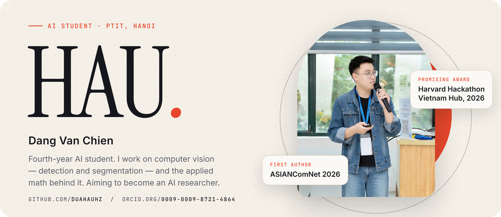
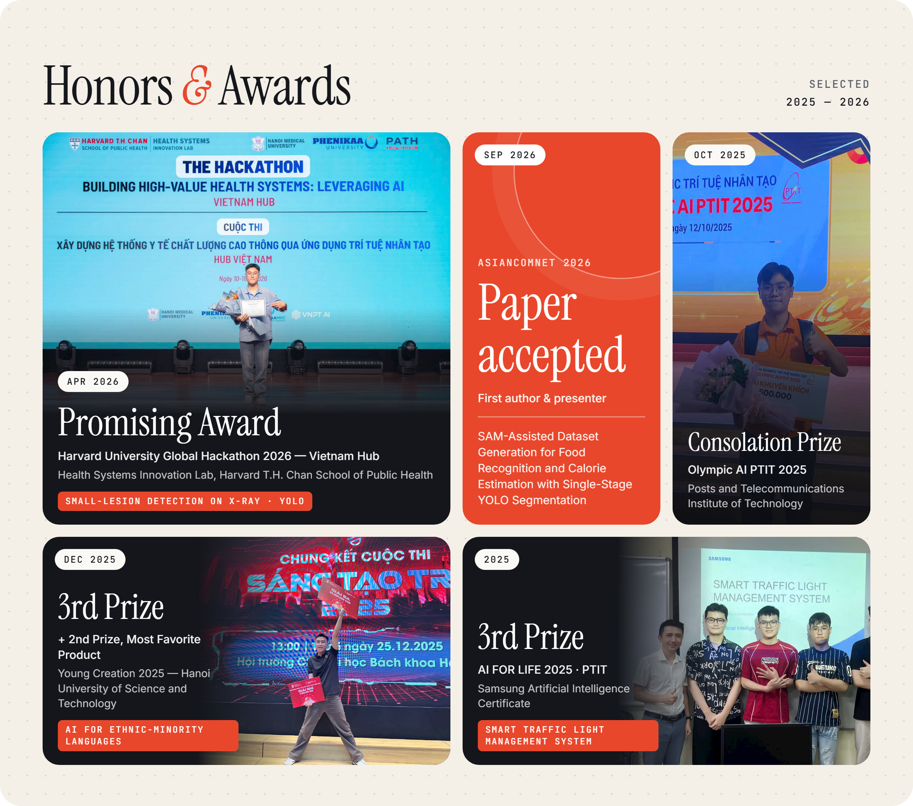
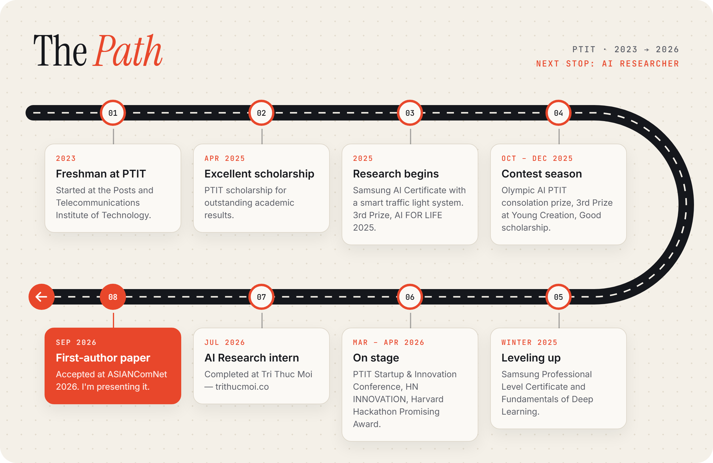

<!-- Profile README for github.com/duahauhz (repo name must be exactly "duahauhz"). -->

  

<a href="https://duahauhz.github.io/"><b>Open the interactive site &rarr;</b></a>

## Hi there

  

- Studying AI at **PTIT**, year 4. Research interests: computer vision and applied mathematics.
- Completed an AI Research internship at [Tri Thuc Moi](https://trithucmoi.co/) in July 2026.
- First-author paper accepted at **ASIANComNet 2026**: *SAM-Assisted Dataset Generation for Food Recognition and Calorie Estimation with Single-Stage YOLO Segmentation*.
- Hobbies: music, books, cooking, and math for fun. English B1.
- Reach me: [ChienDV.B23CE012@stu.ptit.edu.vn](mailto:ChienDV.B23CE012@stu.ptit.edu.vn) &middot; [ORCID 0009-0009-8721-4864](https://orcid.org/0009-0009-8721-4864)

  

  

